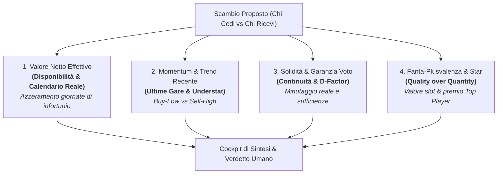

# 📊 Proposta: Algoritmi di Valutazione Scambi & Restyling Grafico UI

Questa proposta risponde direttamente alle due esigenze emerse:
1. **Rendere la valutazione dello scambio immediata e facile da leggere**, superando il muro di 20 metriche numeriche prive di contesto e sostituendole con un cockpit visivo a confronto diretto (*Side-by-Side*).
2. **Ancorare la valutazione alla realtà del campo**, tenendo conto in modo rigoroso di **infortuni, date di rientro stimate, squalifiche e trend di forma reale**.

---

## 🧠 I 4 Algoritmi di Valutazione Proposti

Per consentire al fantallenatore di analizzare uno scambio sotto diverse prospettive strategiche (o di sintetizzarle in un unico indice equilibrato), vengono proposti **4 algoritmi matematici specializzati**:



---

### 1️⃣ Algoritmo: "Valore Netto Effettivo" *(Disponibilità Reale & Calendario Futuro)*
> **Filosofia:** *"Un calciatore porta punti solo se scende in campo: le partite saltate per infortunio o squalifica valgono zero."*

* **Il Problema Attuale:** Fino ad ora il modello proiettava voti pieni per ogni giornata anche se un calciatore era operato al crociato e indisponibile per 5 mesi.
* **Come Funziona:**
  1. Incrocia per ciascun calciatore il database infortuni (`injuries_and_suspensions.json`) e la giornata target stimata di rientro ($G_{\text{rientro}}$).
  2. Per ogni giornata futura $g$ dalla giornata attiva alla 38ª:
     $$\text{xFV}_i(g) = \begin{cases} 0.0 & \text{se } g < G_{\text{rientro}} \text{ (infortunato/squalificato)} \\ P(\text{voto}_i) \cdot \Big[ \text{MV}_i + \text{BonusAttesi}(FDR_g, \text{Casa/Fuori}) \Big] & \text{se disponibile} \end{cases}$$
  3. Se ricevi un calciatore fermo fino a metà Dicembre (15ª giornata) e siamo alla 10ª, il suo contributo per le giornate 10, 11, 12, 13 e 14 è **esattamente 0**, penalizzando severamente l'offerta a meno che non sia bilanciata da un rendimento stratosferico nei mesi successivi.
* **Ideale per:** Valutazioni razionali e a lungo termine sull'effettivo punteggio che entrerà in classifica.

---

### 2️⃣ Algoritmo: "Momentum & Trend Recente" *(Forma Ultime Gare & Sottoperformance Reale)*
> **Filosofia:** *"Nel Fantacalcio vince chi sfrutta il market timing: vendi chi sta overperformando la fortuna, compra chi sta giocando benissimo ma non ha ancora raccolto."*

* **Come Funziona:**
  1. **Peso Forma Recente (60%)**: Calcola l'inerzia positiva o negativa confrontando la FantaMedia delle ultime 3 gare (`FM_Ultime3`) con la media stagionale (`FM_Stagione`):
     $$\Delta_{\text{forma}} = \text{FM\_Ultime3} - \text{FM\_Stagione}$$
  2. **Indice Buy-Low / Sell-High (Understat xG & xA)**:
     - Se un calciatore tira molto e crea tanto (`xG_Tot` elevato) ma ha segnato poco ($\Delta\text{xG} < -0.8$), è un **Buy-Low certificato**: sta per sbloccarsi e il suo valore futuro è in ascesa 📈.
     - Se ha segnato con tiri sporadici e casuali ($\Delta\text{xG} > +1.2$), è un **Sell-High**: rischio elevato di flessione 📉.
  3. **Trend Minutaggio**: Premia i calciatori che nelle ultime settimane hanno scalato le gerarchie (minutaggio in salita) e penalizza chi è scivolato verso la panchina.
* **Ideale per:** Fantallenatori dinamici che vogliono massimizzare il valore di scambio prima che le valutazioni di lega cambino.

---

### 3️⃣ Algoritmo: "Solidità di Rosa & Garanzia del Voto" *(Safety First & D-Factor)*
> **Filosofia:** *"Il peggior danno nel Fantacalcio è giocare in 10 o prendere 4 in pagella: premiare la certezza assoluta della sufficienza."*

* **Come Funziona:**
  1. **Tasso di Sufficienza (% Voti $\ge 6.0$)**: Misura la frequenza con cui il giocatore porta a casa una prestazione positiva senza rischiare insufficienze pesanti.
  2. **Minutaggio Strutturale**: Differenzia nettamente tra:
     - **Titolare Inamovibile** ($\ge 75$ min a gara): affidabilità massima (moltiplicatore 1.0).
     - **Co-Titolare a rotazione** (45-70 min a gara): moltiplicatore 0.82.
     - **Subentrante/Spacca-partita** (< 35 min a gara): moltiplicatore 0.60 per il rischio concreto di senza-voto (S.V.).
  3. **Impatto sul Modificatore di Difesa (D-Factor)**: Per difensori e mediani (Dc, Dd, Ds, E, M), premia chi mantiene costantemente una media voto pura $\ge 6.2$, garantendo punti extra ogni weekend a tutto il reparto.
* **Ideale per:** Chi guida la classifica o punta al podio e non vuole rischiare formazioni scoperte o scommesse azzardate.

---

### 4️⃣ Algoritmo: "Fanta-Plusvalenza & Gerarchia Star" *(Quality over Quantity)*
> **Filosofia:** *"Due mezze figure non fanno un fuoriclasse: uno slot occupato da un Top di reparto vale molto più della somma di due discreti titolari."*

* **Come Funziona:**
  1. **Premio Fuoriclasse (Star Multiplier)**: Nei pacchetti asimmetrici (es. 2 contro 1), il giocatore di punta riceve un sovrapprezzo esponenziale:
     $$\text{Valore Slot Top} \propto (\text{Qualità})^k$$
     Perché avere un Top Player (es. Lautaro, Thuram, Dimarco) lascia libero un secondo slot in rosa per schierare un altro titolare, mentre ricevere due comprimari costringe a mandarne uno in panchina.
  2. **Scambiabilità di Mercato (FVM)**: Tiene conto dell'appeal e del costo d'asta: un big è sempre una moneta pregiata facilmente riscambiabile.
* **Ideale per:** Evitare la tipica "trappola" in cui l'avversario cerca di strapparti il tuo giocatore migliore offrendoti due comprimari di media fascia.

---

## 🎨 Nuovo Design della UI: Semplice, Umano e Diretto

Invece di mostrare 5 file di 4 metriche matematiche astruse, la nuova interfaccia sarà strutturata su **4 livelli gerarchici chiari**:

```
┌────────────────────────────────────────────────────────────────────────┐
│  🟢 VERDETTO: SCAMBIO VANTAGGIOSO (+0.48 xFV/gara a slot)             │
│  "Guadagni un attaccante da 15 gol e aumenti i bonus attesi,           │
│   mantenendo invariata la solidità difensiva."                         │
└────────────────────────────────────────────────────────────────────────┘

┌───────────────────────────────────┬────────────────────────────────────┐
│ 🔴 COSA CEDI                      │ 🟢 COSA RICEVI                     │
├───────────────────────────────────┼────────────────────────────────────┤
│ 👤 Lookman (Atalanta · A)         │ 👤 Thuram (Inter · Pc)             │
│   🚑 In dubbio (Guaio fisico)      │   ✅ Disponibile al 100%           │
│   🟢 Titolare (72' a gara)        │   🟢 Titolare Fisso (84' a gara)   │
│   ⭐ FM 7.82 · 3 Gol, 2 Assist     │   ⭐ FM 8.14 · 5 Gol, 2 Assist     │
│   📈 Understat: 0.42 xG/90        │   📈 Understat: 0.65 xG/90 (Top)   │
└───────────────────────────────────┴────────────────────────────────────┘

┌────────────────────────────────────────────────────────────────────────┐
│ 📊 I 4 PILASTRI DELLO SCAMBIO (Confronto a Colpo d'Occhio)             │
├────────────────────────────────────────────────────────────────────────┤
│ 🎯 Potenziale Bonus / Gol       Ricevi vince (+22% produzione offensiva)│
│ 🛡️ Difesa & Sufficienze         Equilibrio sostanziale (FM ~6.20)      │
│ ⏱️ Continuità & Titolari        Ricevi vince (Più minuti e titolarità) │
│ 📅 Calendario da qui alla 38ª    Cedi ha 2 big match in meno            │
└────────────────────────────────────────────────────────────────────────┘

┌────────────────────────────────────────────────────────────────────────┐
│ 💡 ANALISI DISCORSIVA: PERCHÉ FARLO E COSA RISCHI                      │
│   • 🟢 Vantaggio Chiave: Ricevi una prima punta da scudetto ad altissimo xG.
│   • 🔴 Rischio Principale: Cedi un rigorista; l'Inter farà turnover per la Champions.
│   • 🚑 Infermeria: Nessun lungodegente nel pacchetto, entrambi subito a disposizione.
└────────────────────────────────────────────────────────────────────────┘

[ ▶ Consulta Dati Analitici Avanzati, Tabella FDR e Grafico Timeline ] (Collassato)
```

---

## 🔧 Opzioni di Implementazione per l'Utente

Possiamo implementare:
1. **Un Selettore Rapido della Strategia di Scambio**: Un menu a tendina che permette all'utente di scegliere con quale dei 4 algoritmi valutare lo scambio (*"Resto Stagione con Infortuni"*, *"Momentum Recente"*, *"Solidità & Voto Sicuro"*, *"Qualità Star"*).
2. **Un Modello Ibrido Consensuale (Consigliato)**: Una sintesi ponderata dei 4 algoritmi che genera un punteggio globale affidabile, mostrando comunque i singoli pareri per ciascuna delle 4 aree.
