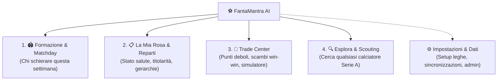

# 🎨 Proposta di UI/UX Revamp: FantaMantra AI

Questo documento definisce il piano strategico per trasformare l'interfaccia di **FantaMantra AI** da una dashboard densa e complessa a un'applicazione moderna, chiara e focalizzata sui flussi di maggior valore per il fantallenatore.

---

## 1. 🔍 Diagnosi dell'UI Attuale (Punti di Attrito)

| Area | Criticità Attuale | Obiettivo del Revamp |
| :--- | :--- | :--- |
| **Sidebar** | Piena di expander tecnici (Admin, Gestione Leghe, API FC.it, Understat, Infortuni, selezioni ridondanti). | Pulizia totale: lasciare solo selettore Squadra/Lega, Giornata e 1 pulsante discreto di stato sync. Tutte le configurazioni finiscono in un menu/modal **Impostazioni**. |
| **Navigazione** | 6 tab principali con sotto-tab annidate (fino a 5 sotto-tab nella sezione statistiche e 4 negli scambi). | Riduzione a **3-4 Macro-Aree chiare** ad alto valore aggiunto. |
| **Densità Visiva** | Troppe tabelle con 20+ colonne, blocchi di testo analitico densi, moltiplicazione di badge e colori. | Gerarchia "Progressive Disclosure": info chiave a colpo d'occhio (Voto, FM, Status, Match), dettagli accessibili al click/hover. |
| **Formazione** | Campo visivamente carico, spiegazioni testuali lunghe per ogni giocatore. | Campo moderno stile *FotMob/SofaScore*, card compatte con i soli 3 numeri che contano, panchina gerarchica chiara. |

---

## 2. 🎯 I 4 Pilastri Fondamentali (Core Features)

Abbiamo identificato i flussi che generano il **90% del valore pratico** per chi gioca al Fantacalcio:

### 🏟️ 1. Formazione & Matchday (La schermata principale di ogni settimana)
- **Top Bar**: Modulo consigliato (es. `3-4-2-1`) e Punteggio Atteso (`xFV`).
- **Campo Visivo Pulito**: Calciatori disposti sul campo con card essenziali:
  - Ruolo e Nome
  - Partita di Serie A e difficoltà (FDR)
  - Probabilità di Voto (`P_Voto%`) e Fantamedia
  - Avviso rapido se in ballottaggio (`⚖️`) o indisponibile (`🔴`)
- **Panchina Intelligente**: Ordinata automaticamente secondo le regole di sostituzione e copertura ruoli Mantra/Classic.
- **Pillole Tattiche Rapide**: 2-3 raccomandazioni sintetiche in cima (es. *"Attenzione: difesa a rischio malus contro Inter; consigliato passare a 4-3-1-2"*).

### 📋 2. La Mia Rosa (Gestione Squadra)
- Visualizzazione a schede per reparto (**Porta**, **Difesa**, **Centrocampo/Fasce**, **Trequarti/Attacco**).
- Tabella sintetica e ordinabile: presenze reali, minuti medi, MV, FM, Status (`Titolare`, `Ballottaggio`, `Infortunato`).
- Indicatore immediato di copertura slot (es. *"Copertura Pc: 2/2 attivi - OK"*).

### 🤝 3. Trade Center (Mercato & Scambi)
Unire i 4 sotto-tab attuali in **2 sole viste intuitive**:
1. **Diagnosi & Opportunità**:
   - Dove la mia rosa è debole (es. *Serve un Ds titolare*) e dove ho surplus cedibile.
   - Lista degli scambi consigliati più vantaggiosi per entrambe le parti, con punteggio di convenienza chiaro.
2. **Simulatore Rapido (Scambio Diretto)**:
   - Seleziona squadra avversaria -> Scegli chi dare e chi ricevere -> Esito immediato (Bilanciamento FVM, Guadagno xFV, impatto sui moduli).

### 🔍 4. Esplora & Scouting (Database Calciatori)
- Eliminare le 5 tabelle frammentate (Top Rendimento, Understat, Portieri, Buy-Low).
- Un'**unica barra di ricerca unificata** con filtri rapidi:
  - *Filtro per Ruolo* (Mantra o Classic)
  - *Filtro per Squadra*
  - *Tag Rapidi*: `🔥 Top FM`, `🎯 Sottoperforma xG (Buy-Low)`, `🛡️ Clean Sheet`, `🟢 Titolari Fissi`
- Tabella pulita e moderna con le metriche che contano davvero.

---

## 3. 🧹 Riorganizzazione della Sidebar

La sidebar deve smettere di essere un pannello di controllo tecnico e diventare un selettore di contesto:
- **Logo & Nome Squadra / Lega** (con switch rapido a tendina se si hanno più leghe).
- **Matchday Attivo**: Giornata 10 (con data e orario prima partita).
- **Badge di Stato Dati**: `🟢 Dati aggiornati (G9)` con un piccolo link/icona per aggiornare.
- **Link Rapido `⚙️ Impostazioni`** in fondo per:
  - Configurazione Leghe / Roster
  - Gestione Admin / Credenziali
  - Import / Export file Excel

---

## 4. 🚀 Fasi di Implementazione Proposte

1. **Fase 1 (Architettura & Layout)**:
   - Creare la nuova barra di navigazione a 4 tab chiare.
   - Snellite la sidebar spostando la parte tecnica in un'area Impostazioni discreta.
2. **Fase 2 (Revamp Matchday & Formazione)**:
   - Ridisegnare le card sul campo e la tabella panchina con un look minimalista e moderno.
3. **Fase 3 (Consolidamento Trade Center)**:
   - Fondere le sotto-schede scambi in un flusso unificato "Diagnosi ➡️ Scambi Consigliati ➡️ Simulatore".
4. **Fase 4 (Scouting Unificato)**:
   - Sostituire le 5 sub-tab statistiche con il motore di ricerca unico e filtri intelligenti.
